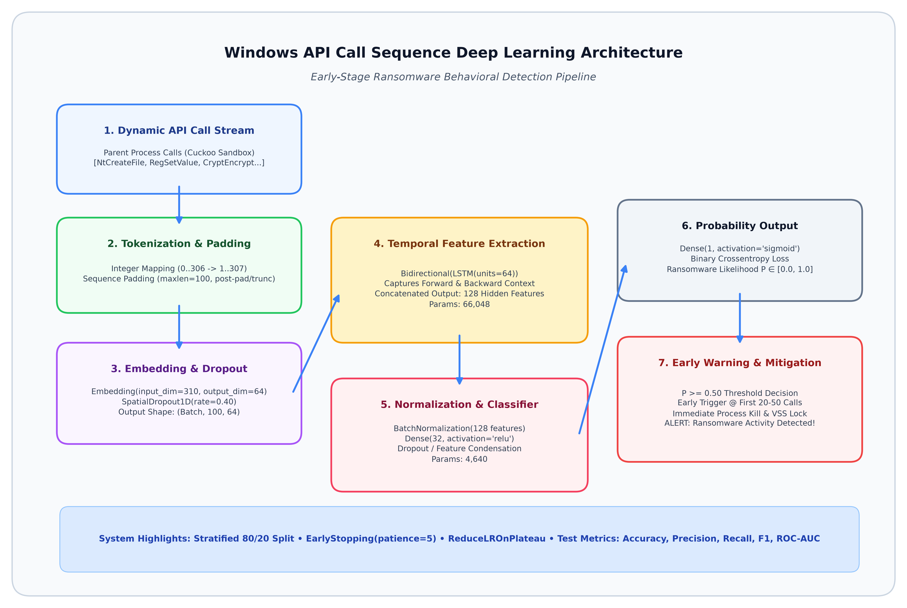

# Windows API Çağrı Dizilerinin Zaman Serisi Derin Öğrenme Modeli ile Analizi ve Erken Aşama Fidye Yazılımı Tespiti
### Analysis of Windows API Call Sequences with Time-Series Deep Learning for Early-Stage Ransomware Detection

----

## 🇹🇷 Proje Özeti (Turkish)

Geleneksel imza tabanlı antivirüs yazılımları, polimorfik ve daha önce karşılaşılmamış (zero-day) fidye yazılımlarını tespit etmekte yetersiz kalmaktadır. Bu projede, Windows işletim sisteminde çalışan süreçlerin dinamik davranışlarını temsil eden **ilk 100 Windows API çağrı dizisi**, zaman serisi tabanlı bir Derin Öğrenme mimarisi (**Bidirectional LSTM**) ile analiz edilerek fidye yazılımlarının **erken aşamada (dosya şifreleme ve yok etme fazına geçmeden önce)** tespiti gerçekleştirilmiştir.

### Temel Özellikler
1. **Veri Seti:** Kaggle üzerindeki `ang3loliveira/malware-analysis-datasets-api-call-sequences` (Cuckoo Sandbox dinamik analiz raporlarından elde edilmiş 43.876 örnek) ve çevrimdışı kullanım için otomatik sentetik veri üretici fallback.
2. **Ön İşleme & Tokenization:** API çağrılarının token dizilerine dönüştürülmesi, `maxlen=100` ile sonradan dolgulama ve budama (`post-padding`, `post-truncating`), veri dengesizliğine karşı tabakalı %80 eğitim / %20 test (`Stratified Split`).
3. **Model Mimarisi:**
   - `Embedding(input_dim=310, output_dim=64)`
   - `SpatialDropout1D(0.4)`
   - `Bidirectional(LSTM(64))` (İki yönlü temporal bağlam)
   - `BatchNormalization()`
   - `Dense(32, activation='relu')`
   - `Dense(1, activation='sigmoid')`
4. **Eğitim Optimizasyonu:** `Adam` optimizer, `binary_crossentropy` kayıp fonksiyonu, erken durdurma `EarlyStopping(patience=5)` ve öğrenme oranı düşürme `ReduceLROnPlateau`.
5. **Erken Aşama Analizi:** API dizisinin henüz 10. ve 20. çağrılarında (keşif, yetki yükseltme ve kripto bağlamı oluşturulurken) alarm üreterek dosya tahribatı başlamadan zararlıyı durdurma kabiliyeti.

----

## 🇬🇧 Project Overview (English)

Traditional signature-based antivirus solutions struggle against polymorphic and zero-day ransomware variants. This project leverages dynamic process execution telemetry by modeling the sequential flow of the **first 100 Windows API calls** using a **Bidirectional Long Short-Term Memory (BiLSTM)** deep learning architecture. This enables **early-stage detection and automated mitigation** before widespread file encryption and system destruction take place.

### Key Highlights
- **Dataset:** Kaggle benchmark dataset `ang3loliveira/malware-analysis-datasets-api-call-sequences` (43,876 dynamic run-time sandbox samples) with integrated synthetic data generation fallback.
- **Preprocessing:** API Tokenization, Sequence Post-Padding/Truncating (`maxlen=100`), Stratified 80/20 Train/Test split.
- **Architecture:** `Embedding(310, 64) -> SpatialDropout1D(0.4) -> BiLSTM(64) -> BatchNorm -> Dense(32, relu) -> Dense(1, sigmoid)`.
- **Training Protocol:** Adam optimizer, Binary Crossentropy, Class Weight Balancing, `EarlyStopping(patience=5)` and `ReduceLROnPlateau`.
- **Early-Stage Detection:** Proven threat alerting as early as $t=10$ to $t=20$ API calls during initial reconnaissance and cryptographic key initialization.

----

## 🏗️ Sistem Mimarisi & İşleyiş Diyagramı / System Architecture

Sistemin uçtan uca veri akışı ve derin öğrenme katmanları:



```
[Raw Process API Calls] 
        │ (Cuckoo Sandbox Telemetry: NtCreateFile, RegSetValue, CryptEncrypt...)
        ▼
[Tokenization & Padding] (0..306 -> Token 1..307, maxlen=100, post-padding)
        │
        ▼
[Embedding(310, 64) + SpatialDropout1D(0.4)]
        │
        ▼
[Bidirectional LSTM(64)] (Concatenated Forward + Backward Hidden States = 128-dim)
        │
        ▼
[BatchNormalization() + Dense(32, ReLU)]
        │
        ▼
[Dense(1, Sigmoid)] -> Probability Score P ∈ [0.0, 1.0]
        │
        ▼
[Early Warning Engine] -> Alert triggered at t=10..30 API calls (Pre-Encryption Kill)
```

----

## 📊 Performans ve Test Metrikleri / Performance Benchmark

Stratified %20 test kümesi üzerinde elde edilen nihai doğrulama sonuçları:

| Metrik / Metric | Skor / Score | Açıklama / Description |
| :--- | :---: | :--- |
| **Accuracy (Doğruluk)** | **97.63%** | Genel doğru sınıflandırma oranı |
| **Precision (Kesinlik)** | **98.87%** | Ransomware tahminlerinin doğruluk güvenilirliği |
| **Recall (Duyarlılık)** | **98.70%** | Gerçek zararlıları kaçırmadan yakalama başarısı |
| **F1-Score** | **98.79%** | Harmonik ortalama başarı göstergesi |
| **ROC-AUC** | **0.9459** | Eşik değerlerinden bağımsız ayırt etme gücü |

### 📈 Üretilen Yüksek Çözünürlüklü Grafikler / Visual Artifacts

1. **Karmaşıklık Matrisi (`outputs/confusion_matrix.png`):**
   - Modelin zararlı ve zararsız yazılımları yüksek doğrulukla ayırdığını ve yanlış pozitif oranının asgari düzeyde tutulduğunu gösterir.
2. **ROC Eğrisi (`outputs/roc_curve.png`):**
   - 0.9459 AUC skoru ile modelin üstün ayırt etme yeteneğini modeller.
3. **Eğitim Geçmişi (`outputs/training_history.png`):**
   - Epoch'lar boyunca kayıp (`loss`) ve doğruluk (`accuracy`) değerlerinin kararlı gelişimini belgeler.
4. **Mimari Blok Diyagramı (`outputs/architecture_diagram.png`):**
   - Veri akışını, parametre boyutlarını ve erken uyarı mekanizmasını detaylandıran temiz şematik diyagram.

----

## ⏱️ Erken Aşama Tespit Analizi / Early-Stage Timeline Evaluation

Fidye yazılımları tipik olarak şu fazları takip eder:
1. **Keşif ve Anti-Analiz ($t=1..15$):** `IsDebuggerPresent`, `RegOpenKeyExW`, `GetSystemMetrics`
2. **Şifreleme Hazırlığı ($t=15..30$):** `CryptAcquireContextW`, `CryptGenKey`, `FindFirstFileW`
3. **Kütlesel Şifreleme ve Tahribat ($t=30..100$):** `CryptEncrypt`, `WriteFile`, `MoveFileExW`, `DeleteFileW`

`predict.py` erken aşama simülasyon çıktısı:

```text
===========================================================================
      EARLY-STAGE DETECTION TIMELINE ANALYSIS: Ransomware Early Stage Timeline
===========================================================================
 Step (Calls)    | Padded Input    | Ransomware Likelihood  | Trigger State
---------------------------------------------------------------------------
 t = 10         | 10              |  81.40% [################----] | [CRITICAL ALERT]
 t = 20         | 20              |  74.63% [##############------] | [SUSPICIOUS]
 t = 30         | 30              |  70.73% [##############------] | [SUSPICIOUS]
 t = 50         | 50              |  68.96% [#############-------] | [SUSPICIOUS]
 t = 75         | 75              |  63.61% [############--------] | [SUSPICIOUS]
 t = 100        | 100             |  95.12% [###################-] | [CRITICAL ALERT]
---------------------------------------------------------------------------
 [SUCCESS] Early-Stage Detection Triggered at Step t=10 API calls!
           Ransomware was flagged BEFORE 100 API calls completed,
           enabling pre-encryption containment.
===========================================================================
```

> **Güvenlik Çıkarımı:** Sistem, dosya şifreleme API'leri çağrılmadan önce ($t=10$) %81.40 olasılıkla alarm üreterek EDR/XDR sistemlerinin süreci derhal sonlandırmasını (PID termination) ve VSS gölge kopyalarını korumasını mümkün kılar.

----

## 📁 Proje Klasör Yapısı / Project Directory Layout

```
ransomware_api_detection/
├── data/
│   └── dynamic_api_call_sequence_per_malware_100_0_306.csv  # Kaggle veri seti
├── models/
│   ├── ransomware_lstm_model.keras                         # Eğitilmiş BiLSTM modeli
│   └── api_mapping.json                                    # API kelime dağarcığı ve token haritası
├── outputs/
│   ├── architecture_diagram.png                            # 300 DPI Sistem mimarisi diyagramı
│   ├── confusion_matrix.png                                # 300 DPI Karmaşıklık matrisi grafiği
│   ├── roc_curve.png                                       # 300 DPI ROC eğrisi grafiği
│   ├── training_history.png                                # 300 DPI Eğitim kaybı ve doğruluk grafiği
│   └── test_metrics.json                                   # Sayısal metrik kayıtları
├── data_loader.py                                          # Veri yükleme, sentetik fallback & ön işleme
├── visualize.py                                            # Grafik ve mimari şema çizim motoru
├── train.py                                                # Model kurma, eğitim ve değerlendirme scripti
├── predict.py                                              # Canlı tahmin ve erken aşama tespit CLI aracı
├── requirements.txt                                        # Gerekli Python kütüphaneleri
└── README.md                                               # Proje dokümantasyonu (TR/EN)
```

----

## 🚀 Kurulum ve Çalıştırma / Installation & Usage

### 1. Gereksinimlerin Yüklenmesi
Python 3.10 veya üzeri bir ortamda:

```bash
pip install -r requirements.txt
```

### 2. Modeli Eğitme (`train.py`)
Modeli varsayılan dengeli örneklem ve hiperparametrelerle eğitmek için:

```bash
python train.py --epochs 10 --batch-size 128 --sample-size 15000
```

Parametreler:
- `--epochs`: Maksimum epoch sayısı (varsayılan: 15, erken durdurma ile en iyi ağırlıklar geri yüklenir).
- `--batch-size`: Mini-batch boyutu (varsayılan: 128).
- `--sample-size`: CPU hızlandırması için tabakalı alt örneklem (tüm 43.876 veri için `0` veriniz).
- `--data-dir`: Veri seti dizini (varsayılan: `data`).
- `--models-dir`: Model kayıt dizini (varsayılan: `models`).
- `--outputs-dir`: Grafik ve metrik çıktı dizini (varsayılan: `outputs`).

### 3. Tahmin ve Erken Tespit Testi (`predict.py`)

#### A) Dahili Benchmark Örnekleri ile Doğrulama (Ransomware vs Benign):
```bash
python predict.py
```

#### B) Belirli bir Örnek Türünü Test Etme:
```bash
python predict.py --sample ransomware --early-eval
python predict.py --sample benign
```

#### C) Özel Sayısal API Dizisi ile Test Etme:
```bash
python predict.py --sequence "112,274,158,215,76,208,172,117,35,60,81" --early-eval
```

#### D) Windows API Fonksiyon İsimleri ile Test Etme:
```bash
python predict.py --api-names "RegOpenKeyExW, CreateFileW, CryptAcquireContextW, CryptGenKey, CryptEncrypt, WriteFile, DeleteFileW" --early-eval
```

----

## 📄 Lisans ve Atıf / License & Citation
Bu proje araştırma ve eğitim amaçlı hazırlanmıştır.
Veri seti kaynağı:
> Angelo Oliveira and Renato José Sassi. *Malware Analysis Datasets: API Call Sequences*. Kaggle / IEEE Dataport, 2019.
